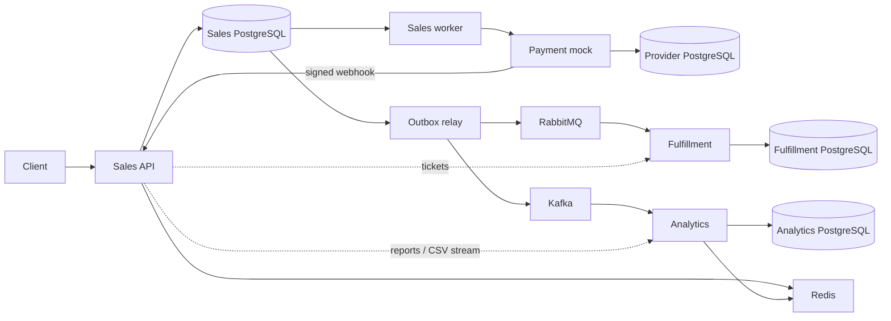

# Архитектура и контракты

## Владение данными

Sales — модульное приложение с одной транзакционной PostgreSQL-базой. Каталог владеет мероприятиями и остатком, orders — состоянием и снимком заказа, payments — локальными платежами, заданиями и квитанциями webhook, messaging — outbox и доставками. Checkout координирует их публичные прикладные порты. Межмодульные JOIN находятся в явно выделенных адаптерах чтения `PgOrderQueries` и `PgCatalogQueries`.

Payment mock, Fulfillment и Analytics имеют собственные базы и роли. Межсервисных SQL JOIN и записей в чужие таблицы нет. Payment mock моделирует внешнюю платёжную систему. Разделение не выносит резервирование мест из локальной транзакции Sales.

Слои: domain, application, infrastructure, presentation, composition. Бизнес-слои используют порты и не импортируют драйверы или SDK телеметрии. HTTP-контроллеры проверяют транспортный контракт и вызывают прикладную операцию. Composition связывает конкретные адаптеры; явные composition-экспорты позволяют корню приложения соединять модули. Bootstrap запускает выбранную композицию. Эти правила проверяются `pnpm check:architecture` для всех приложений.

## Транзакции и жизненный цикл

`POST /orders` атомарно сохраняет бронь, остаток, локальный платёж и ключ идемпотентности. Бронь действует десять минут, максимум до начала мероприятия. Поля цены и мероприятия являются снимком покупки. Повтор создания возвращает первоначальный ответ; отдельный GET возвращает актуальное состояние.

Состояния заказа: `reserved`, `confirmed`, `cancelled`, `expired`. Состояния платежа: `not_started`, `pending`, `succeeded`, `failed`, `refund_pending`, `refunded`. Отмена оплаченного заказа не ждёт внешнего возврата. Успешная оплата после отмены или истечения требует возврата и не подтверждает заказ.

Переходы существующего заказа сначала блокируют заказ, затем при необходимости мероприятие, затем платёж. Worker проверяет условия повторно внутри транзакции. Одно освобождение соответствует одному переходу из состояния, занимающего места. Вместимость не может оказаться ниже занятых мест.

Внешний HTTP-вызов выполняется после коммита платёжного задания. Аренда хранится в PostgreSQL; обновление задания проверяет её владельца. Сверка получает актуальное состояние провайдера и исправляет неопределённые результаты. Webhook сохраняется после проверки подписи исходного тела, времени, платежа и идентичности события. Его повтор не является повторным списанием.

## События и проекции

Новые события: `order.confirmed`, `order.cancelled`, `order.refunded`, формат `version: 2`. Оболочка содержит `messageId`, `occurredAt`, `orderRevision`, неизменный снимок `order` и полный `state` с датами переходов. Исторический `order.confirmed v1` читается как подтверждённое состояние начальной ревизии. Типы и runtime-парсеры находятся в `@ticketing/contracts`.

Outbox допускает несколько сообщений заказа с уникальностью `(order_id, order_revision)`. Направления RabbitMQ и Kafka независимы. Kafka key остаётся `order.eventId`; существующая история topic сохраняется. Rabbit routing key — `<type>.v<version>`; очереди билетов и уведомлений принимают старый и новые форматы.

Получатели сверяют идентичность сообщений и версии заказа. Повторный messageId с другим содержимым — ошибка. Устаревшее состояние не отменяет более новое. Полный снимок позволяет корректно применить новое состояние при пропуске промежуточной доставки.

Fulfillment сохраняет версию общего состояния и независимый прогресс каждого обработчика. Билеты имеют признак действительности, уведомления — назначение. API Sales дополнительно учитывает локальную отмену, пока Fulfillment ещё догоняет события. Недоступность внутреннего HTTP сохраняет отдельный ответ `503`.

Analytics хранит `projection_orders` отдельно для каждой проекции и поколения. Получение новой ревизии меняет агрегаты на разницу вкладов. Квитанция, состояние заказа, агрегаты и ревизия поколения коммитятся вместе; Kafka offset подтверждается после коммита. Продажи и возвраты имеют отдельные суммы. Дневные продажи относятся к дате подтверждения, возвраты — к дате завершения; все дни определяются в UTC.

Replay использует новые поколения и группы, сохраняет прежнюю проекцию до переключения. Два отчёта независимы. Запись в старый формат агрегатов запрещена до миграционного replay. Одновременно работает один управляющий runtime Analytics.

## HTTP, потоки и телеметрия

Пользовательские права и CSRF проверяются в Sales. Внутренние запросы передают `X-Internal-Token` и проверенный контекст владельца. Webhook имеет отдельную HMAC-аутентификацию. Локальные секреты — в `.env.example`.

Списки каталога и заказов возвращают `{items,nextCursor}`. PATCH мероприятия требует `version`. Публичный CSV `/reports/orders.csv` передаёт поток из `/internal/reports/orders.csv` Analytics. Даты фильтра включены и относятся к подтверждению покупки. SQL-курсор использует отдельный пул, согласованный снимок и порции по 500 строк. Backpressure и отмена проходят через всю HTTP-цепочку.

`@ticketing/observability` владеет OpenTelemetry SDK, spans, propagation и метриками. Контекст сохраняется отдельно от бизнес-события и не участвует в его fingerprint. Collector экспортирует traces в Jaeger и метрики в Prometheus; Grafana содержит готовый dashboard. Ошибка экспорта телеметрии не отменяет бизнес-операцию.

## Миграции и локальное исполнение

Мигратор применяет новые SQL-файлы под advisory lock с checksum в каждой базе. `upgrade:state` запускается при остановленных процессах приложения: импортирует старые успешные учебные платежи и перестраивает старые проекции по полной истории Kafka. Только эта отдельная миграционная команда читает метаданные нескольких владельцев; обычные сервисы так не работают. Перенос идемпотентен и защищён от параллельного запуска.

`pnpm dev` выполняет подготовку и запускает шесть процессов. HTTP и инфраструктурные порты привязаны к loopback; отдельная сеть диагностики имеет настраиваемую подсеть. Все полные проверки используют собственные базы, темы, очереди и префиксы Redis. Данные демонстрационного приложения не удаляются.
